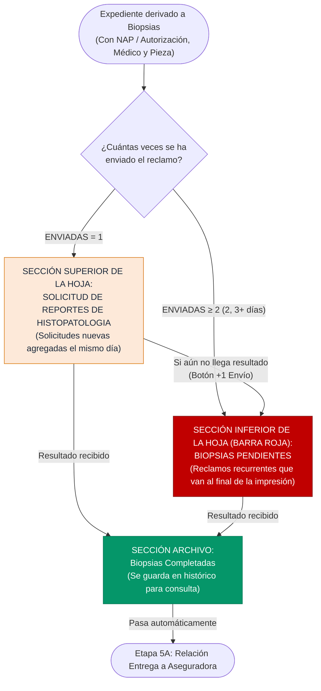
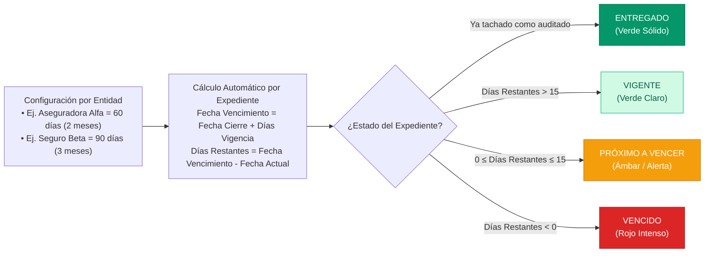

# GESTION DE CALIDAD — Sistema de Control de Expedientes, Auditoría Médica y Relaciones de Entrega

Plataforma web integral con base de datos interna persistente (**SQLite en modo WAL**) diseñada para la trazabilidad completa, auditoría clínica, control de glosas, seguimiento de histopatología/biopsias y emisión de relaciones oficiales de entrega de **Expedientes Hospitalarios** y **Atenciones de Emergencia**.

> [!IMPORTANT]
> **Instalación 100% Limpia (Cero Datos Precargados):**
> Al clonar o duplicar este repositorio, el sistema inicia **completamente vacío y desde cero**: sin usuarios predefinidos, sin nombres de pacientes internos y sin aseguradoras precargadas. Todo el catálogo (Cuenta Administrador Root, Usuarios por Rol, Aseguradoras/Entidades, Plazos de Vigencia y Expedientes) se configura desde cero al iniciar el proyecto.

---

## 1. Gráfica de Inicialización desde Cero (Onboarding al Iniciar el Proyecto)

Cuando se despliega el contenedor o se inicia el proyecto por primera vez, el sistema detecta que la base de datos está vacía y guía la configuración inicial en 4 pasos:


---

## 2. Gráfica del Proceso de Expedientes Hospitalarios (7 Etapas y Cadena de Custodia)

El flujo de **Expedientes** controla quién emite, quién recibe, quién audita y a qué entidad se entrega cada relación diaria:

```mermaid
flowchart TD
    subgraph FAC_IN ["Área de Facturación (Emisión)"]
        E1["1. Emisión Recepción (Facturación)<br/>• Registra paciente, NAP/Autorización, Aseguradora y Cobertura<br/>• Genera relación diaria de envío hacia Auditoría"]
    end

    subgraph ADMIN_COTEJO ["Área Administrativa de Auditoría"]
        E2["2. Recepción Administrativa (Cotejo)<br/>• Tacha y acepta llegada física de los expedientes<br/>• Asigna el Médico Auditor responsable"]
    end

    subgraph MED_AUDIT ["Área de Auditoría Médica Interna"]
        E3["3. Relación a Auditores Médicos<br/>• Pestañas estilo Excel por cada Médico Auditor creado<br/>• Control de Fecha de Vencimiento, Días Restantes y Estado<br/>• Aplica glosas y emite reporte clínico"]
    end

    subgraph ADMIN_DECISION ["Área Administrativa (Retorno y Derivación)"]
        E4["4. Recepción de Auditores<br/>• Administrativo confirma retorno del expediente auditado<br/>• Evalúa si está completo o requiere Biopsia / Caso Especial"]
        Decision{"¿Tiene Biopsia o<br/>Pendiente Especial?"}
    end

    subgraph SUB_BIOPSIAS ["Seguimiento de Histopatología"]
        E5B["5B. Relación de Biopsias / Casos Especiales<br/>• Parte 1: Nuevas del día (Enviadas = 1 vez)<br/>• Parte 2: Biopsias Pendientes (Enviadas ≥ 2 veces)<br/>• Al completarse se archiva en histórico y pasa a Entrega"]
    end

    subgraph ADMIN_ENTREGA ["Entrega Dividida por Pestañas de Aseguradora"]
        E5A["5A. Relación Entrega a Aseguradora<br/>• Pestañas estilo Excel arriba y abajo por cada Entidad<br/>  (Ej. TODAS | ASEGURADORA ALFA | SEGURO BETA | COBERTURA GLOBAL)<br/>• Impresión de acta oficial por entidad y fecha"]
    end

    subgraph FAC_FINAL ["Área de Facturación (Cierre y Radicación)"]
        E6["6. Entrega Final a Facturación<br/>• Pestañas estilo Excel divididas por Aseguradora<br/>• Facturación confirma recepción final para cobro"]
    end

    E1 -->|"Entrega relación inicial"| E2
    E2 -->|"Coteja y asigna auditor"| E3
    E3 -->|"Emite reporte y glosa"| E4
    E4 --> Decision
    Decision -->|"Sí (Falta Biopsia)"| E5B
    Decision -->|"No (Expediente Completo)"| E5A
    E5B -->|"Biopsia Completada y Archivada"| E5A
    E5A -->|"Remisión final"| E6

    style E1 fill:#0284c7,stroke:#0369a1,color:#fff
    style E2 fill:#2563eb,stroke:#1d4ed8,color:#fff
    style E3 fill:#d97706,stroke:#b45309,color:#fff
    style E4 fill:#0d9488,stroke:#0f766e,color:#fff
    style E5B fill:#7c3aed,stroke:#6d28d9,color:#fff
    style E5A fill:#4f46e5,stroke:#4338ca,color:#fff
    style E6 fill:#059669,stroke:#047857,color:#fff
```



---

## 3. Gráfica del Proceso de Atenciones de Emergencia (4 Etapas)

Las atenciones de **Emergencia** cuentan con un circuito ágil de 4 etapas y soporte para ingesta masiva desde sistemas externos (HIS):


---

## 4. Gráfica del Sub-Proceso de Biopsias e Histopatología

En la etapa **5B. Relación de Biopsias**, tanto la vista en pantalla como el documento oficial imprimible dividen automáticamente los registros en dos bloques dentro de la misma hoja, además de contar con un archivo histórico de completadas:



---

## 5. Gráfica de Vigencia y Semáforo de Vencimiento por Aseguradora (SLA)

El **Administrador Root** (o **Administrativo**) define desde cero cuántos días o meses de vigencia tiene cada Aseguradora/Entidad antes de que venza el expediente desde su `FECHA CIERRE`. Tanto los **Auditores Médicos** como los **Administrativos** visualizan en tiempo real el cálculo:



---

## 6. Matriz de Roles, Permisos y Visibilidad por Etapa (RBAC)

Cada usuario inicia sesión con sus credenciales y visualiza únicamente las etapas que corresponden a su rol:

| Rol del Sistema | Etapas que Visualiza | Permisos y Acciones Principales |
| :--- | :--- | :--- |
| **`ADMIN_ROOT`**<br/>*(Administrador Root)* | **Todas las etapas** (Expedientes y Emergencias) | Crear y gestionar usuarios y permisos, crear y configurar Aseguradoras y sus días de vigencia, operar cualquier etapa, cierres anuales y pruebas de rendimiento. |
| **`FACTURACION`**<br/>*(Facturación y Emisión)* | **1. Emisión Recepción** y **6. Entrega Final a Facturación** | Emitir la relación inicial de expedientes/emergencias hacia Auditoría y confirmar la recepción final dividida por pestañas de Aseguradora para cobro. |
| **`ADMINISTRATIVO`**<br/>*(Administrativo de Auditoría)* | **Todas las etapas operativas** | Tachar y aceptar llegada física en **Cotejo**, asignar y relacionar expedientes a **Auditores Médicos**, confirmar retorno en **Recepción de Auditores**, gestionar **Biopsias**, entregar por pestañas a **Aseguradoras** y emitir **Entrega Final a Facturación**. |
| **`AUDITOR_MEDICO`**<br/>*(Auditor Médico Clínico)* | **3. Relación a Auditores Médicos** y **4. Recepción de Auditores** | Filtrar su propia pestaña de auditor, monitorear fechas de vencimiento y días restantes, confirmar recepción física, aplicar montos glosados y emitir el reporte de auditoría médica. |

---

## 7. Guía de Configuración desde Cero (Qué Implica en Cada Sección)

Dado que el proyecto no incluye datos precargados en el repositorio, al iniciarlo por primera vez sigue este orden:

1. **Sección 1 — Creación del Administrador Root (Al abrir `http://localhost:4000`):**
   - Al no existir usuarios en la base de datos SQLite, la pantalla de inicio muestra automáticamente el formulario **"Configuración Inicial desde Cero"**.
   - Ingresa tu nombre, correo electrónico, contraseña y departamento para crear la cuenta `ADMIN_ROOT`.
2. **Sección 2 — Creación de Usuarios y Auditores (`Usuarios y Permisos`):**
   - Haz clic en el botón **Usuarios y Permisos** en la barra superior.
   - Crea al menos un usuario para cada rol del flujo:
     - **Facturación (`FACTURACION`):** quien emitirá las relaciones iniciales y recibirá la entrega final.
     - **Administrativo (`ADMINISTRATIVO`):** quien hará el cotejo, asignación a auditores, seguimiento de biopsias y entregas.
     - **Auditores Médicos (`AUDITOR_MEDICO`):** cada usuario creado con este rol generará automáticamente su propia **pestaña estilo Excel** en el módulo `ENTREGA DE EXPEDIENTES A AUDITORIA INTERNA`.
3. **Sección 3 — Creación de Aseguradoras y Plazos de Vencimiento (`Vigencias ARS` / Botón `+`):**
   - Haz clic en **Vigencias ARS** en la barra superior (o en el botón **`+ Crear Aseguradoras (ARS)`** en la barra de pestañas tipo Excel).
   - Registra desde cero los nombres de las aseguradoras o entidades con las que trabajará la institución (por ejemplo: `ASEGURADORA ALFA`, `SEGURO BETA`, `COBERTURA GLOBAL`) y asigna a cada una sus días límite de vigencia (`30`, `60`, `90` días o personalizado).
   - Al guardar, estas entidades aparecerán en los selectores de creación de expedientes y en las **barras de pestañas superiores e inferiores estilo Excel** en las etapas de *Entrega a Aseguradora* y *Entrega Final a Facturación*.
4. **Sección 4 — Emisión de Expedientes, Emergencias y Relaciones por Día:**
   - Usa **`+ Emitir Expediente`**, **`+ Emitir Emergencia`** o **`+ Fila Rápida (1 Línea)`** para registrar pacientes reales o de prueba.
   - Si escribes una nueva aseguradora al crear un registro, el sistema la incorpora automáticamente al catálogo de pestañas.
   - Todas las entregas quedan agrupadas en línea en la barra **Relaciones por Día de Entrega** y muestran la trazabilidad real (`ENTREGADO POR` → `RECIBIDO POR`).

---

## 8. Despliegue con Docker (Puerto 4000)

### Requisitos
- Docker y Docker Compose instalados.

### Levantar el Proyecto
```bash
docker compose up -d --build
```
La aplicación y su API con base de datos SQLite persistente (almacenada localmente en `./data/audit_database.sqlite`, ignorada por Git) estarán disponibles en:
- **Acceso local:** `http://localhost:4000`
- **Acceso en red local (LAN):** `http://<IP_DEL_SERVIDOR>:4000`

### Desarrollo Local (Sin Docker)
```bash
npm install
npm run build
npm start
```
